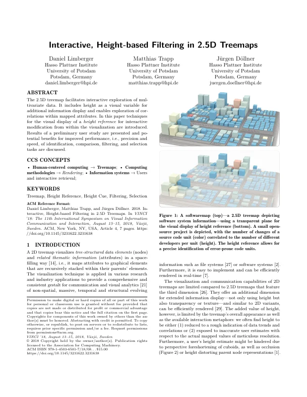
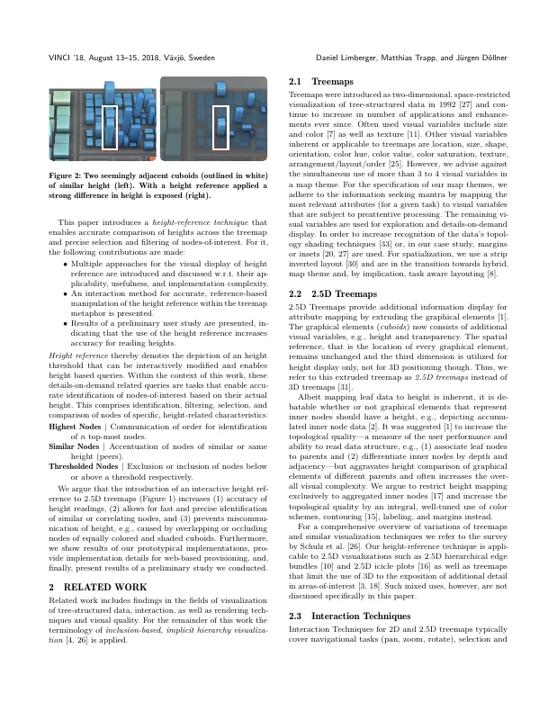
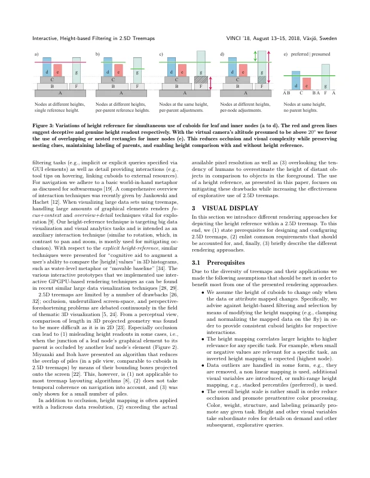
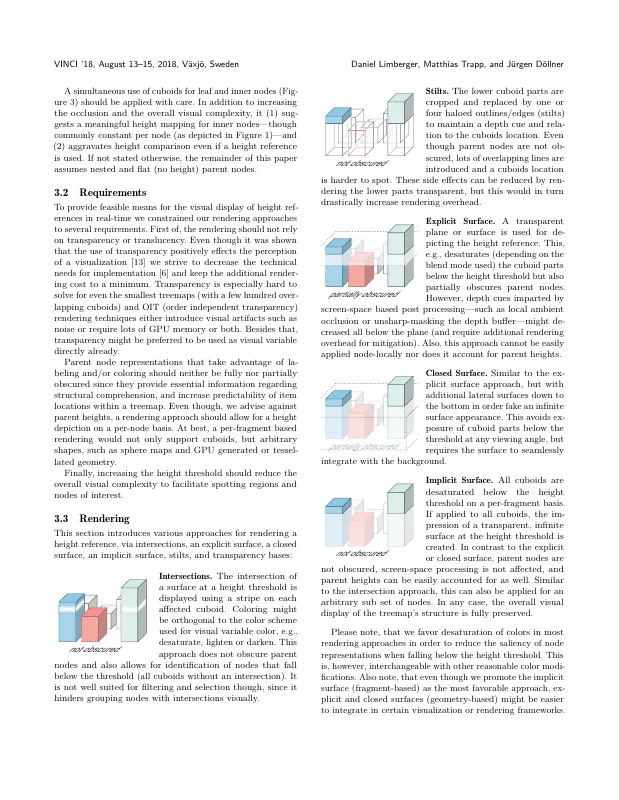
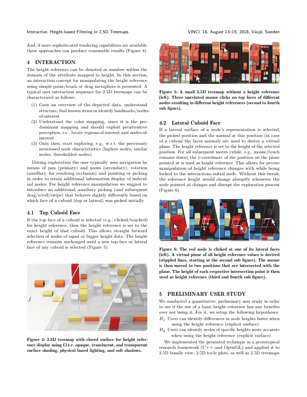
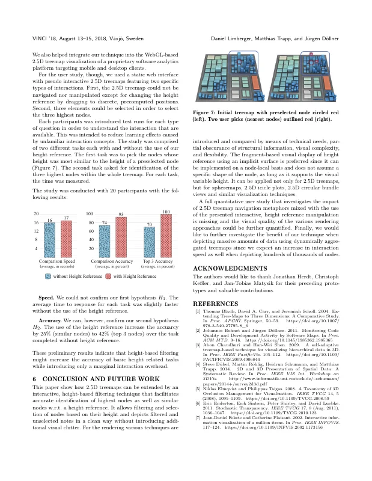
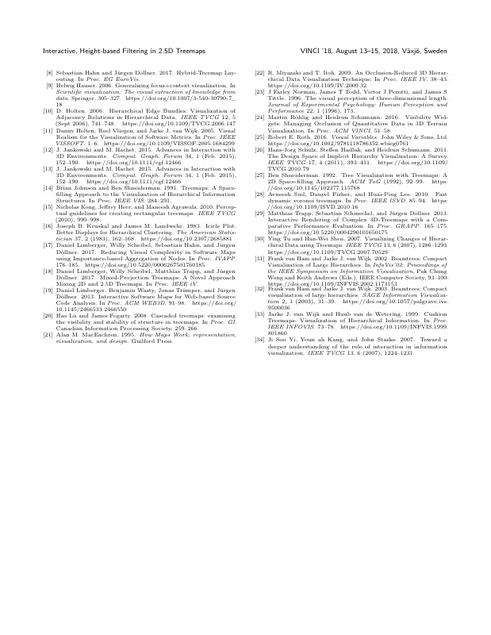

# Interactive, Height-based Filtering in 2.5D Treemaps

[Daniel Limberger](https://orcid.org/0000-0002-9111-4809), [Matthias Trapp](https://orcid.org/0000-0003-3861-5759), and [Jürgen Döllner](https://orcid.org/0000-0002-8981-8583)

*Proceedings of the 11th International Symposium on Visual Information Communication and Interaction (VINCI '18)*, August 13–15, 2018, Växjö, Sweden. ACM, pp. 49–55.

DOI: [10.1145/3231622.3231638](https://doi.org/10.1145/3231622.3231638) · Author's version: [Zenodo](https://doi.org/10.5281/zenodo.24176593) · [ResearchGate](https://www.researchgate.net/publication/326728307)

> The 2.5D treemap facilitates interactive exploration of multivariate data.
> It includes height as a visual variable for additional information display and enables exploration of correlations within mapped attributes.
> In this paper techniques for the visual display of a height reference for interactive modification from within the visualization are introduced.
> Results of a preliminary user study are presented and potential benefits for improved performance, i.e., precision and speed, of identification, comparison, filtering, and selection tasks are discussed.

<p><a href="limberger2018-filtering-as-submitted.pdf"></a> <a href="limberger2018-filtering-as-submitted.pdf"></a> <a href="limberger2018-filtering-as-submitted.pdf"></a> <a href="limberger2018-filtering-as-submitted.pdf"></a></p>
<details><summary>Remaining 3 pages</summary><p><a href="limberger2018-filtering-as-submitted.pdf"></a> <a href="limberger2018-filtering-as-submitted.pdf"></a> <a href="limberger2018-filtering-as-submitted.pdf"></a></p></details>

## Contents

- [`src/`](src/) – LaTeX sources of the camera-ready version (ACM `acmart`, sigconf)
- [`limberger2018-filtering-as-submitted.pdf`](limberger2018-filtering-as-submitted.pdf) – camera-ready PDF as submitted to ACM (2018-06-28)
- [`slides/`](slides/) – LaTeX sources of the talk (beamer)
- [`limberger2018-filtering-slides.pdf`](limberger2018-filtering-slides.pdf) – slides as presented at VINCI 2018
- [`build.sh`](build.sh) – reproducible build of paper and slides (podman or docker)
- [`preview/`](preview/) – page previews for this README

## Build

```bash
./build.sh          # → build/vinci2018.pdf
./build.sh author   # → build/vinci2018-author.pdf (acmart "authorversion" notice instead of the ACM permission block)
./build.sh slides   # → build-slides/vinci-refsurface.pdf
```

The paper was built with TeX Live 2017 and its `acmart.cls` (v1.50, 2018/02/07); the build reproduces `limberger2018-filtering-as-submitted.pdf` pixel-identically.
The `acmart.dtx` (v1.53) shipped with the camera-ready sources was not used for the original PDF (its copyright block reads "licensed to ACM" instead of "licensed to the Association for Computing Machinery") and is therefore not included.
The slides were built with TeX Live 2018; the build matches `limberger2018-filtering-slides.pdf` in text and layout (raster images render marginally differently).

## Credits

The slides contain third-party images; the iceberg (`slides/images/iceberg.jpg`, slide "Software Maps — Goals") is from [Geo a Day](https://geoaday.tumblr.com/) by Jeremiah Shaw and Danny Jones (2013).

## Versions

- [`v1.0-camera-ready`](https://github.com/dl-archive/article.2018-vinci-reference/tree/v1.0-camera-ready) – sources as submitted to ACM, and the talk

## Citation

```bibtex
@InProceedings{limberger2018-filtering,
  author    = {Limberger, Daniel and Trapp, Matthias and D{\"o}llner, J{\"u}rgen},
  title     = {Interactive, Height-Based Filtering in 2.5D Treemaps},
  booktitle = {Proceedings of the 11th International Symposium on Visual Information Communication and Interaction},
  year      = {2018},
  series    = {VINCI~'18},
  publisher = {ACM},
  pages     = {49--55},
  doi       = {10.1145/3231622.3231638},
  isbn      = {978-1-450365-01-7},
}
```
